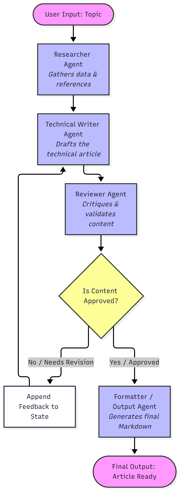
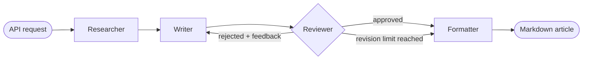

# CogniMesh: Autonomous Multi-Agent Content Engine

> A multi-agent system built with Python, LangGraph and Google Gemini that autonomously researches, drafts, reviews and formats technical articles, with a built-in quality loop that rejects weak drafts before they are published.

## Highlights

- **Specialized agents, single responsibility:** each agent has one job, one persona and one temperature tuned for it.
- **Explicit state machine:** the workflow is a LangGraph graph, so every transition is declared, inspectable and testable.
- **Automated quality gate:** a strict Reviewer agent can send the draft back to the Writer until it passes.
- **Bounded cost:** the revision loop has a hard limit, so a stubborn draft can never cause unbounded LLM calls.
- **Knowledge injected from Markdown files:** style, review and formatting rules live in `app/knowledge/` and can be changed without touching code.
- **One-command deployment:** fully containerized with Docker Compose.

## Agent Workflow





| Agent | Responsibility | Temperature | Knowledge base |
|---|---|---|---|
| **Researcher** | Breaks the topic into core concepts, trade-offs, use cases/anti-patterns and tooling | `0.2` | n/a |
| **Writer** | Turns the research into an article; on revisions, addresses the Reviewer's feedback | `0.3` | `style_guide.md` |
| **Reviewer** | Evaluates the draft against the research and returns a structured verdict | `0.1` | `review_strategies.md` |
| **Formatter** | Adds YAML frontmatter and TL;DR, and outputs the final Markdown | `0.1` | `formatting_guidelines.md` |

## How the Agents Communicate

Agents never call each other directly. They communicate **only through a shared, typed state** (`AgentState` in `app/graph/state.py`) that LangGraph passes along the graph. Each node receives the current state and returns only the fields it changes.

| State field | Written by | Read by | Purpose |
|---|---|---|---|
| `topic` | API | all agents | Subject of the article |
| `research_data` | Researcher | Writer, Reviewer | Source of truth for the content |
| `draft_content` | Writer | Reviewer, Formatter | Current article draft |
| `is_approved` | Reviewer | Router | Quality gate result |
| `review_feedback` | Reviewer | Writer | Actionable fixes for the next draft |
| `revision_count` | Reviewer | Router | Loop counter |
| `final_output` | Formatter | API | Publishable Markdown |

Why this matters:

- **Loose coupling:** agents can be replaced, reordered or extended without changing one another.
- **Traceability:** the Reviewer judges the draft against the *same* `research_data` the Writer used, so claims without a source can be caught.
- **Closed feedback loop:** `review_feedback` is injected into the Writer's prompt as a revision instruction on the next pass.
- **Deterministic control flow:** routing is plain Python (`review_router` in `app/graph/builder.py`), not an LLM decision: approved goes to the Formatter, rejected goes back to the Writer, and hitting the limit goes to the Formatter.

## Quality Assurance

Quality is enforced by the architecture, not left to a single prompt:

- **Independent review:** drafting and reviewing are done by separate agents with different personas, so the Writer does not grade its own work.
- **Structured verdict:** the Reviewer returns a validated Pydantic schema (`is_approved`, `feedback`) via structured output, so routing never depends on parsing free text.
- **Explicit evaluation matrix** (`app/knowledge/review_strategies.md`):
  - **Hallucination control:** the draft must not add concepts, statistics or metrics that are absent from the research.
  - **Fluff detection:** generic introductions and conversational conclusions are rejected.
  - **Density and formatting:** objective text and correct use of inline code.
  - **Feedback protocol:** feedback must be specific, locate the faulty section and describe how to fix it.
- **Low temperatures** (`0.1` to `0.3`) favor consistent, factual output.
- **Style and format consistency:** the Writer and the Formatter apply the same guides on every run, so articles follow one house style and one portable Markdown format.
- **Bounded revision loop:** `MAX_REVISIONS = 3` in `app/graph/builder.py` caps the number of review cycles.

> **Note:** if the limit is reached without approval, the latest draft is still sent to the Formatter to avoid infinite loops. Treat the revision count in the response as a quality signal.

## Security

Implemented:

- **Secrets stay out of the code and the image:** `GOOGLE_API_KEY` is read from the environment. `.env` is listed in both `.gitignore` and `.dockerignore`, and Compose injects it at runtime through `env_file`. Only `.env.example` is versioned.
- **Minimal attack surface:** the container uses `python:3.11-slim` and exposes a single port (`8000`).
- **Input validation:** request bodies are validated by Pydantic schemas in FastAPI.
- **No leaked internals by design:** the API returns the article and summary metrics, not prompts or intermediate agent state.
- **Cost control:** the bounded revision loop also limits abuse of paid LLM calls per request.
- **Container health monitoring:** `/health` is wired to a Docker `HEALTHCHECK`.

Before exposing it publicly, harden the following:

- Add authentication (API key or OAuth2) and rate limiting; the endpoints are currently open.
- Replace the wildcard CORS origin in `main.py` with your frontend URL.
- Run the container as a non-root user and terminate TLS at a reverse proxy.
- Limit the `topic` length and treat it as untrusted input, since it is placed in LLM prompts (prompt injection).

## System Architecture

```
cogni-mesh-agents-app/
├── main.py               # FastAPI entrypoint (endpoints and schemas)
├── app/
│   ├── core/             # Settings (environment variables) and shared helpers
│   ├── agents/           # Researcher, Writer, Reviewer and Formatter nodes
│   ├── graph/            # LangGraph state, nodes, edges and routing logic
│   ├── knowledge/        # Style, review and formatting guides injected into prompts
│   ├── tools/            # Reserved for external tools (e.g., web search)
│   └── api/              # Reserved for API routers
├── public/               # Workflow diagram
├── .env.example          # Required environment variables
├── Dockerfile            # Application image
├── docker-compose.yml    # Local orchestration
└── requirements.txt      # Python dependencies
```

## Technologies Used

- **Python 3.11** (container image)
- **LangGraph** and **LangChain** (graph orchestration)
- **Google Gemini** through `langchain-google-genai` (default model: `gemini-2.5-flash`)
- **FastAPI** and **Uvicorn** (API)
- **Pydantic** (validation and structured output)
- **Docker** and **Docker Compose** (containerization)

## How to Run

Prerequisites: Docker with Docker Compose and a [Google AI Studio](https://aistudio.google.com/) API key.

1. Create your environment file and set the key:

   ```bash
   cp .env.example .env
   # edit .env and set GOOGLE_API_KEY=your_key
   ```

   On Windows PowerShell, use `Copy-Item .env.example .env`.

2. Build and start:

   ```bash
   docker compose up --build
   ```

3. Open the interactive docs at <http://localhost:8000/docs> or check <http://localhost:8000/health>.

Optional: set `DEFAULT_MODEL_NAME` in `.env` to use a different Gemini model.

## API

| Method | Endpoint | Description |
|---|---|---|
| `POST` | `/api/v1/generate-article` | Runs the workflow and returns JSON |
| `POST` | `/api/v1/generate-article/download` | Runs the workflow and returns a `.md` file |
| `GET` | `/health` | Health check |

```bash
curl -X POST http://localhost:8000/api/v1/generate-article \
  -H "Content-Type: application/json" \
  -d '{"topic": "Event Sourcing vs CRUD"}'
```

Example response:

```json
{
  "topic": "Event Sourcing vs CRUD",
  "final_output": "---\ntitle: ...\n---\n> **TL;DR:** ...",
  "revisions_made": 2,
  "research_data_points": 24
}
```

A run chains several LLM calls and can take from 15 to 30 seconds or more.

## Customizing Behavior

- **Writing, review and formatting rules:** edit the files in `app/knowledge/`; no code change is needed.
- **Revision limit:** change `MAX_REVISIONS` in `app/graph/builder.py`.
- **Model:** set `DEFAULT_MODEL_NAME` in `.env`.
